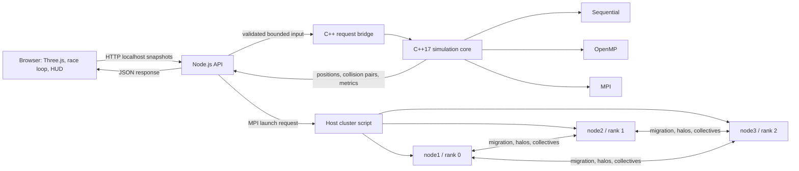

# Arquitectura integrada de Neon Rush

## Diagrama de componentes

## Responsabilidades

### Navegador

- Three.js renderizado, cámara, entradas de usuario, HUD y visualización.
- JavaScript es el modo predeterminado y mantiene los controles, aceleración,
  velocidad, dirección, IA de rivales, obstáculos, colisiones, progreso y
  renderizado.
- Envía IDs globales, posición X/Z, velocidad, dirección, radio, estado activo,
  pasos, `deltaTime` y modo cuando se elige C++ experimental.
- En secuencial/OpenMP se aplica al jugador el desplazamiento lineal calculado
  por C++; JavaScript sigue gobernando velocidad, aceleración, dirección y los
  demás sistemas de carrera. No es una transferencia completa de la física al
  backend.
- MPI se mantiene en sombra: por su latencia de lanzamiento/comunicación no se
  aplica su posición a la carrera.
- Los rivales y sus adelantamientos permanecen bajo la IA JavaScript.
- La respuesta física de colisiones se mantiene en los sistemas JavaScript;
  las detecciones C++ son telemetría y no sustituyen esa respuesta.

### API Node.js local

- Atiende HTTP únicamente en loopback y aplica CORS local, límites, validación
  de esquema y exclusión mutua de trabajos.
- Convierte la solicitud JSON a un protocolo privado sencillo para el proceso
  C++ y valida/serializa su respuesta.
- Ejecuta secuencial/OpenMP mediante el binario local. Para MPI, delega al
  lanzador del clúster; nunca acepta un comando arbitrario del navegador.
- Administra timeout, desconexión y error y devuelve una respuesta explícita.

### Núcleo C++17

- Reutiliza el mismo `Vehicle`, movimiento y cuadrícula de colisiones que las
  pruebas y benchmarks anteriores.
- Secuencial/OpenMP consumen el snapshot enviado por HTTP.
- MPI distribuye estado entre ranks, mantiene migración y halos, y devuelve el
  resultado reunido al rank raíz.
- Las posiciones y pares devueltos provienen del motor C++; el adaptador no
  simula resultados en JavaScript.

## Ciclo de una actualización

1. El frontend crea un snapshot con IDs estables para jugador y rivales.
2. Node valida modo, IDs únicos, campos finitos, pasos, tiempo y límites.
3. El adaptador ejecuta el motor C++ según el modo seleccionado.
4. El proceso C++ integra el movimiento rectilíneo con velocidad/dirección
   recibidas y detecta colisiones circulares; no calcula aceleración, giro,
   pista ni resolución de impactos.
5. Node responde con el mismo identificador de solicitud.
6. El navegador valida el `requestId`. En secuencial/OpenMP aplica al jugador
   el delta de posición C++ durante el intervalo del snapshot. Si la respuesta
   tarda más de 300 ms, falla o no corresponde a la solicitud vigente, cambia
   a física JavaScript sin detener la carrera. IA, pista, colisiones,
   checkpoints, vueltas y renderizado siguen en JavaScript.

El cliente no manda una solicitud por fotograma: secuencial/OpenMP acumulan
hasta aproximadamente 10 Hz y MPI hasta 2 Hz. Solo una solicitud puede estar
activa; un trabajo concurrente puede devolver HTTP 409. Secuencial/OpenMP
gobiernan parcialmente la posición del jugador, no una carrera completa. MPI
es un observador en sombra.

## Operación y límites

El frontend nunca accede a Docker directamente. La integración MPI requiere el
servicio local y el clúster Docker ya arrancado. MPI de uno, dos o tres ranks
debe usar el mismo ejecutable OpenMPI y el mismo snapshot inicial. En el modo
de tres contenedores, los ranks se distribuyen en node1, node2 y node3; estos
contenedores comparten CPU, memoria y red del equipo anfitrión.

El motor actual no es un servidor persistente: los procesos se lanzan por
cada actualización. Los benchmarks de API separados documentan latencia HTTP,
tiempo del kernel y recursos del proceso; MPI incluye el lanzamiento de
procesos/Compose en la latencia. MPI no se usa para controlar el movimiento de
la carrera. Para una integración completa se necesitarían un proceso C++
persistente, un protocolo versionado y sincronización autoritativa probada.
