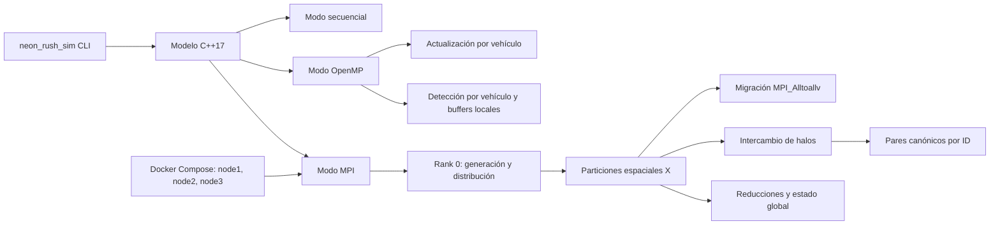

# Arquitectura paralela de Neon Rush

## Alcance del modelo

La Fase 5 contiene un motor C++17 independiente del navegador. Los tres modos
simulan el mismo modelo plano XZ: vehículos con ID global estable, posición,
velocidad escalar no negativa, dirección, radio y estado activo. Cada paso
actualiza posición con `x += cos(dirección) * velocidad * deltaTime` y
`z += sin(dirección) * velocidad * deltaTime`, y detecta solapamientos de
círculos mediante una cuadrícula uniforme. La simulación actual no calcula
respuesta física a colisiones, pista, aceleración o dirección variable.

## Componentes principales

- `Vehicle` define el estado y la generación determinista de cargas sintéticas.
- `Simulation` conserva el camino secuencial y selecciona modo y número de
  hilos. `RaceState` acumula pasos, detecciones y tiempos de fases.
- `CollisionSystem` construye la cuadrícula, busca candidatos y detecta pares
  circulares. No modifica los vehículos ni resuelve contactos.
- `MpiSimulation` mantiene particiones, migra vehículos, actualiza halos,
  contabiliza detecciones y recoge resultados solo cuando se requieren para
  verificación.
- `neon_rush_sim` ofrece modos secuencial, OpenMP, MPI, comparación y barrido;
  las ejecuciones de comparación validan el estado antes de informar tiempos.

## Secuencial

El bucle de movimiento actualiza el vector de vehículos en orden. La
construcción de la cuadrícula y la detección de colisiones se ejecutan sin
hilos. Sirve de referencia determinista para comparar los otros modos con
idénticas condiciones iniciales, delta de tiempo y pasos.

## OpenMP

El bucle de movimiento usa trabajo estático por índice. Cada iteración lee y
escribe un vehículo distinto. Para colisiones, la cuadrícula ya construida es
de solo lectura; cada hilo procesa primeros vehículos distintos y escribe en
su propio buffer. El merge, ordenamiento, construcción de cuadrícula y otras
reducciones siguen siendo secuenciales.

La independencia del movimiento evita dependencias entre iteraciones. Los
buffers por hilo evitan escrituras concurrentes en una lista compartida. Un
par se emite una sola vez por orden de índice. Los resultados se ordenan para
dar una salida reproducible.

## MPI distribuido

Rank 0 crea la condición inicial determinista y la reparte con `MPI_Scatterv`.
La propiedad se asigna a franjas de celdas espaciales en X. En cada paso:

1. Cada rank actualiza sus vehículos locales.
2. Colectivas determinan el rango de celdas ocupado y su propietario.
3. Los vehículos que cruzan una franja migran mediante `MPI_Alltoallv`.
4. Se intercambian como halos los vehículos en las celdas vecinas necesarias
   para buscar colisiones de frontera.
5. El propietario del vehículo con menor ID global emite cada par. Los pares
   se ordenan y deduplican antes de recogerlos.
6. Conteos y tiempos se reducen globalmente. El tiempo total informado es el
   transcurrido por el proceso más lento e incluye las comunicaciones del run.

La simulación no ejecuta una copia global redundante en todos los ranks. El
estado global solo se reúne al comparar resultados. La partición en una
dimensión y sus colectivas frecuentes son simples y correctas para esta carga,
pero pueden causar desequilibrio y comunicación elevada.

## Clúster Docker

`infrastructure/mpi-cluster/compose.yaml` crea tres contenedores de una misma
imagen Ubuntu 24.04/OpenMPI. `node1` coordina y también ejecuta el rank 0;
`node2` y `node3` reciben ranks cuando el tamaño MPI lo solicita. Una red
Compose interna conecta los nombres DNS. OpenMPI usa SSH no interactivo con
claves locales en volúmenes, host keys separadas y verificación estricta.
La configuración no publica puertos, no usa contenedores privilegiados y no
monta el socket Docker.

Los contenedores comparten CPU, memoria y red del mismo equipo anfitrión; no
constituyen un clúster físico. Ver el hostname de cada rank confirma la
distribución entre contenedores, no independencia de hardware.

## Qué paraleliza y qué sigue serial

| Operación | Secuencial | OpenMP | MPI |
|---|---|---|---|
| Actualización de posición | Vector en orden | Índices independientes en paralelo | Vehículos locales en cada rank |
| Cuadrícula de colisiones | Secuencial | Construcción secuencial | Cuadrícula local/candidatos locales |
| Búsqueda de pares | Secuencial | Iteraciones y buffers por hilo | Propietario local y halos |
| Migración/halos | No aplica | No aplica | Comunicaciones MPI por paso |
| Merge, ordenamiento y estadísticas | Secuencial | Merge y ordenamiento secuenciales | Colectivas/ordenamiento local |

No se ha medido ni declarado un porcentaje de código paralelizable de 60–70 %.
La fracción académica debe definirse con un perfil y con límites de fases bien
delimitados; los tiempos de fase completos también contienen trabajo serial.
