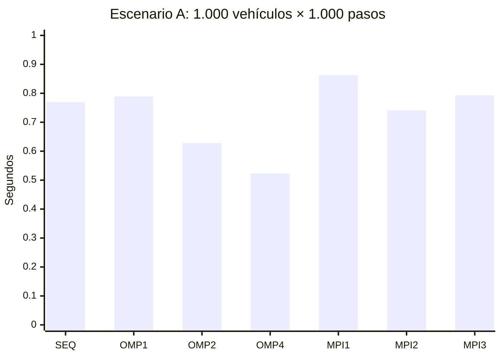
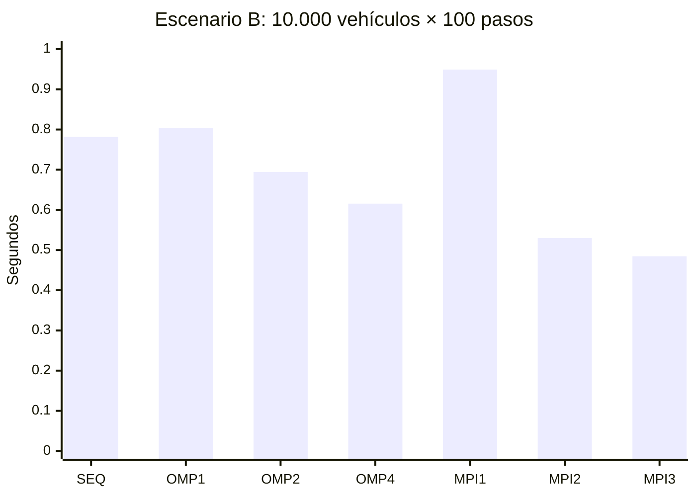
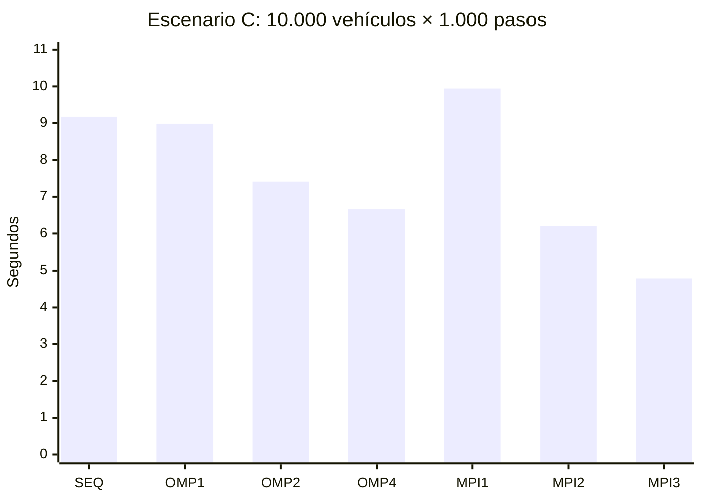

# Resultados de rendimiento de Neon Rush — Fase 7 (cierre)

## Resumen final

Los resultados que siguen corresponden a la validación final y real ejecutada en este entorno. No se mezclan con benchmarks históricos ni se inventan mediciones.

| Modo | Tiempo total (s) | Speedup | Eficiencia |
|---|---:|---:|---:|
| OpenMP 4 hilos | 0.443272382 | 1.450125449 | 0.362531362 |
| MPI 2 procesos | 0.551841805 | 1.277227161 | 0.638613581 |
| MPI 3 procesos | 0.633009917 | 1.195424586 | 0.398474862 |

Las tres modalidades reportan 160718 colisiones y un checksum compatible con la referencia secuencial, dentro de la tolerancia de la simulación determinista.

---

# Resultados de rendimiento de Neon Rush — Fase 5

## Alcance y método

Las mediciones de este informe se realizaron en una sola sesión y en el mismo
clúster Docker; no se mezclan con los benchmarks históricos del directorio
`benchmarks/`. Cada configuración se ejecutó cinco veces y se informa la
mediana. Las cargas mantuvieron las mismas condiciones deterministas,
`deltaTime = 1/60 s`, semilla/configuración del simulador y pasos para cada
comparación.

| Escenario | Vehículos | Pasos |
|---|---:|---:|
| A | 1.000 | 1.000 |
| B | 10.000 | 100 |
| C | 10.000 | 1.000 |

Se midió el tiempo total de pared junto con las fases de movimiento y
colisiones. El informe MPI utiliza el tiempo transcurrido del rank más lento;
incluye coordinación y comunicación del run. La columna de comunicación es
el tiempo de comunicación MPI medido por el programa. Las fases MPI se
reducen por separado al máximo de ranks y, por ello, no tienen por qué sumar
el tiempo total ni ser aditivas entre sí.

La comparación calcula el speedup con su propia referencia secuencial
emparejada: OpenMP usa el baseline secuencial del mismo barrido y cada tamaño
MPI usa la referencia secuencial ejecutada en ese `mpi-compare`. Los valores
de `T sec.` indican ese denominador. La ejecución secuencial independiente
también se lista; no se usa como denominador si no corresponde a esa
comparación.

## Entorno

- Host: Ubuntu 26.04.1 LTS, Intel Core i5-1035G1, 8 CPU lógicas.
- Memoria informada por Docker: aproximadamente 11,67 GB.
- Docker Engine 29.9.2; Docker Compose 5.6.1.
- Contenedores: Ubuntu 24.04, GCC 13.3.0, CMake 3.28.3, OpenMPI 4.1.6.
- OpenMP usa hasta 4 hilos en estos barridos.
- Los procesos MPI de 1/2/3 ranks se ejecutaron con OpenMPI en los
  contenedores node1/node2/node3. La configuración de 3 ranks confirmó un
  rank por contenedor.

Los contenedores comparten el CPU, la memoria y la red de un único host. Los
resultados no representan un clúster de tres máquinas físicas ni una red de
centro de datos.

## Escenario A — 1.000 vehículos × 1.000 pasos

Tiempos en segundos; `mov. / col. / comm.` son movimiento, colisiones y
comunicación. `—` significa que no aplica.

| Modo (workers / nodos) | Total | Mov. | Col. | Comm. | T sec. emparejado | Speedup | Eficiencia |
|---|---:|---:|---:|---:|---:|---:|---:|
| Secuencial (1 / 1) | 0,769523 | 0,034178 | 0,711600 | — | — | — | — |
| OpenMP 1 hilo (1 / 1) | 0,789135 | 0,033574 | 0,747125 | — | 0,824624 | 1,0450 | 1,0450 |
| OpenMP 2 hilos (2 / 1) | 0,628043 | 0,025043 | 0,573327 | — | 0,824624 | 1,3130 | 0,6565 |
| OpenMP 4 hilos (4 / 1) | 0,522585 | 0,018335 | 0,485277 | — | 0,824624 | 1,5780 | 0,3945 |
| MPI 1 rank (1 / 1) | 0,862407 | 0,033855 | 0,682048 | 0,004166 | 0,805979 | 0,9346 | 0,9346 |
| MPI 2 ranks (2 / 2) | 0,740549 | 0,019160 | 0,363451 | 0,275743 | 0,868195 | 1,1724 | 0,5862 |
| MPI 3 ranks (3 / 3) | 0,792962 | 0,013502 | 0,229847 | 0,506519 | 0,885730 | 1,1170 | 0,3723 |

## Escenario B — 10.000 vehículos × 100 pasos

| Modo (workers / nodos) | Total | Mov. | Col. | Comm. | T sec. emparejado | Speedup | Eficiencia |
|---|---:|---:|---:|---:|---:|---:|---:|
| Secuencial (1 / 1) | 0,781532 | 0,033039 | 0,741372 | — | — | — | — |
| OpenMP 1 hilo (1 / 1) | 0,804127 | 0,034078 | 0,762143 | — | 0,877178 | 1,0908 | 1,0908 |
| OpenMP 2 hilos (2 / 1) | 0,694408 | 0,022359 | 0,660028 | — | 0,877178 | 1,2632 | 0,6316 |
| OpenMP 4 hilos (4 / 1) | 0,615477 | 0,016302 | 0,592200 | — | 0,877178 | 1,4252 | 0,3563 |
| MPI 1 rank (1 / 1) | 0,949133 | 0,034475 | 0,787284 | 0,001218 | 0,819013 | 0,8629 | 0,8629 |
| MPI 2 ranks (2 / 2) | 0,530134 | 0,018640 | 0,331895 | 0,079544 | 0,925979 | 1,7467 | 0,8733 |
| MPI 3 ranks (3 / 3) | 0,484612 | 0,013557 | 0,279606 | 0,202963 | 0,969056 | 1,9997 | 0,6666 |

## Escenario C — 10.000 vehículos × 1.000 pasos

| Modo (workers / nodos) | Total | Mov. | Col. | Comm. | T sec. emparejado | Speedup | Eficiencia |
|---|---:|---:|---:|---:|---:|---:|---:|
| Secuencial (1 / 1) | 9,176447 | 0,343372 | 8,743274 | — | — | — | — |
| OpenMP 1 hilo (1 / 1) | 8,985505 | 0,337121 | 8,564113 | — | 9,451808 | 1,0519 | 1,0519 |
| OpenMP 2 hilos (2 / 1) | 7,410253 | 0,215841 | 7,101489 | — | 9,451808 | 1,2755 | 0,6378 |
| OpenMP 4 hilos (4 / 1) | 6,657291 | 0,150968 | 6,414331 | — | 9,451808 | 1,4198 | 0,3549 |
| MPI 1 rank (1 / 1) | 9,942766 | 0,334510 | 8,396081 | 0,011055 | 8,834015 | 0,8885 | 0,8885 |
| MPI 2 ranks (2 / 2) | 6,201838 | 0,180647 | 4,253313 | 0,813692 | 9,671039 | 1,5594 | 0,7797 |
| MPI 3 ranks (3 / 3) | 4,788695 | 0,137993 | 2,816284 | 1,499700 | 10,478608 | 2,1882 | 0,7294 |

Los tiempos MPI en una ejecución local de varios contenedores no equivalen a
la latencia de tres hosts. Los tiempos secuenciales emparejados de cada
comparación también varían, por lo que se conserva explícitamente el
denominador realmente usado por el programa.

## Gráficos: tiempo total mediano

Segundos; se muestran las siete configuraciones en el orden indicado.

## Análisis

### Distribución por fases

La siguiente tabla muestra cada mediana de fase como porcentaje del tiempo
total de esa configuración; son razones de tiempos medidos, no fracciones
del código que sean paralelizables.

| Escenario | Modo | Movimiento | Colisiones | Comunicación MPI |
|---|---|---:|---:|---:|
| A | Secuencial independiente | 4,4 % | 92,5 % | — |
| A | OpenMP 4 | 3,5 % | 92,9 % | — |
| A | MPI 3 | 1,7 % | 29,0 % | 63,9 % |
| B | Secuencial independiente | 4,2 % | 94,9 % | — |
| B | OpenMP 4 | 2,6 % | 96,2 % | — |
| B | MPI 3 | 2,8 % | 57,7 % | 41,9 % |
| C | Secuencial independiente | 3,7 % | 95,3 % | — |
| C | OpenMP 4 | 2,3 % | 96,4 % | — |
| C | MPI 3 | 2,9 % | 58,8 % | 31,3 % |

En MPI las duraciones de las fases son máximos de ranks calculados
independientemente; la mediana total es el máximo del tiempo total por
repetición. Por eso los porcentajes pueden no sumar 100 % (por ejemplo, en
B), y no deben interpretarse como una descomposición aditiva exacta del
tiempo de pared.

La detección de colisiones domina los modos secuencial y OpenMP. OpenMP
reduce las fases paralelas, pero la construcción/merge de la cuadrícula,
ordenamiento y otros trabajos seriales limitan el escalado. El escenario A
mejora al aumentar a 4 hilos; B y C alcanzan speedups menores. En MPI, 3
ranks mejora claramente B y C, mientras que A sufre el costo de comunicación:
en A, las comunicaciones reportadas consumen cerca del 64 % del total MPI de
3 ranks. Para cargas pequeñas, migración, halos, sincronización y coordinación
pueden superar el trabajo ahorrado.

Los speedups OpenMP de 1 hilo son ligeramente superiores a 1. Esto refleja
variación entre ejecuciones y diferencias en el overhead de las rutas de
benchmark, no una aceleración paralela superlineal. La eficiencia `S(p)/p`
también puede exceder 1 para `p=1` por la misma razón; no es una señal de
escalamiento superlineal.

### Ley de Amdahl y fracción paralelizable

Con la fórmula idealizada `S(p)=1/((1-P)+P/p)`, despejar `P` de los speedups
OpenMP de 4 hilos da fracciones **Amdahl-equivalentes** aproximadas de 48,8 %
(A), 39,8 % (B) y 39,4 % (C). Son estimaciones derivadas de la aceleración
observada y suponen ausencia de overhead; no son un perfil ni una medición
del porcentaje de líneas/instrucciones paralelizables. El costo de crear o
sincronizar hilos y las secciones seriales reducen el speedup, así que no se
puede concluir que exactamente esa fracción del código sea paralela.

Como referencia teórica, si `P` fuese 60 % o 70 %, el límite ideal con 4
trabajadores sería aproximadamente 1,82× o 2,11×, respectivamente. La
implementación no demuestra haber alcanzado la meta académica del 60–70 %;
haría falta perfilado por funciones y regiones, con el mismo workload y una
definición operacional de la fracción.

MPI no sigue directamente ese modelo ideal: las particiones, migración,
halos, reducciones, arranque de ranks y comunicación añaden costos. Aumentar
de dos a tres ranks puede reducir tiempo de colisiones y a la vez elevar
comunicación y desequilibrio. En una sola máquina, los procesos además
compiten por los mismos núcleos y ancho de banda.

## Corrección y cobertura de ejecución

- Las comparaciones MPI incluidas en cada escenario informaron que el estado
  de vehículos y los pares de colisión coinciden con la referencia
  secuencial. El estado se compara con la tolerancia numérica implementada;
  los identificadores y pares canónicos deben coincidir exactamente.
- Conteos de pares detectados por workload: A 160.718, B 95.551 y C
  2.579.465. Las comparaciones MPI dieron el mismo conteo y validaron que no
  hubiera divergencias en los pares.
- El test de MPI en los tres contenedores cubrió 5/5 verificaciones; CTest en
  el contenedor pasó 4/4 pruebas. También se verificaron DNS/conectividad,
  OpenMPI y la colocación `rank 0=node1`, `rank 1=node2`, `rank 2=node3`.
- La suite incluye casos de migración, halos, colisiones de frontera,
  particiones vacías y pares duplicados. Estos resultados no prueban
  rendimiento de una red física.

## Validación final de Fase 5

- Backend secuencial/OpenMP en el host: compilación Release correcta y CTest
  1/1 aprobado. El host no tiene `mpirun`/`mpicxx`; la validación MPI se
  ejecutó en Docker.
- Clúster Docker: ciclo `down` → reconstrucción/`up` → `verify` → `test`
  correcto. Los tres nodos reportaron OpenMPI 4.1.6; `verify` distribuyó los
  ranks 0/1/2 en node1/node2/node3. CTest del contenedor: 4/4; suite MPI
  explícita entre contenedores: 5/5. El clúster quedó detenido al finalizar y
  se conservaron los volúmenes de claves para futuros reinicios.
- Frontend, sin cambios durante esta fase: `npm test` aprobó 11/11 y
  `npm run build` finalizó correctamente. Vite informó que el bundle JavaScript
  minificado supera 500 kB; es una advertencia, no un fallo de compilación.
- También pasaron la validación de configuración Compose, la sintaxis de los
  scripts shell y `git diff --check`.
- No se realizó una comprobación visual en navegador.

## Conclusiones y mejoras

1. La cuadrícula reduce la búsqueda de candidatos, pero la detección de
   colisiones sigue dominando el costo local. Es la oportunidad principal
   para perfilar la construcción de celdas, el balance de trabajo y la
   localidad de memoria.
2. OpenMP es la ruta más simple para compartir los núcleos de una máquina.
   El beneficio observado es moderado y depende del escenario.
3. MPI 3 ranks ofrece el mejor resultado de la matriz en C (4,789 s,
   `S=2,188` frente a su referencia emparejada) y en B (0,485 s,
   `S=2,000`). No mejora A frente a la ejecución secuencial.
4. Antes de optimizar, repetir en un host dedicado sin otras cargas,
   registrar dispersión (mínimo/máximo o percentiles además de la mediana) y
   separar costo de inicialización, cálculo y comunicación con timers
   consistentes. A continuación, evaluar más tamaños de problema y una
   partición MPI con balanceo y comunicación amortizada.
5. Para una afirmación académica sobre 60–70 % paralelizable, usar un
   profiler y documentar las regiones medidas; speedup por sí solo no
   certifica ese porcentaje.
